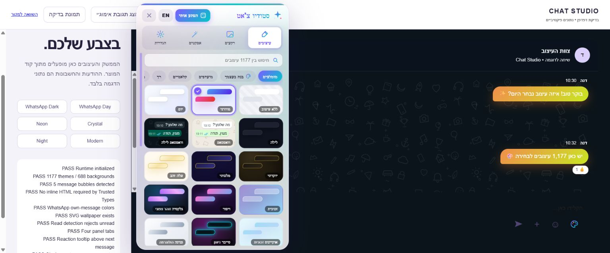
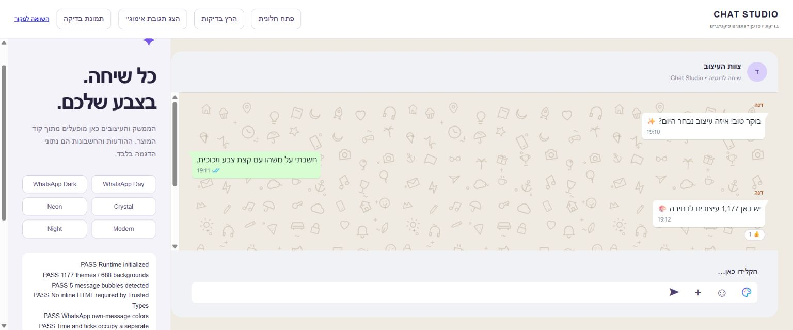
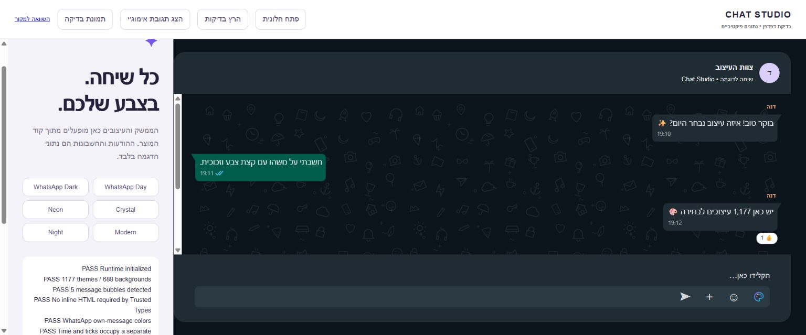

# Chat Studio · Prozi

**הצ׳אט שלך. העיצוב שלך.** כל עיצובי Chat Studio V15.3, בגרסת Tampermonkey עצמאית.



**גרסת פיתוח: 15.3.1-beta.2.** אינה שחרור יציב. [דוח הבדיקות](TEST_REPORT.md) מפריד בין בדיקות קוד, fixture בדפדפן ותרחישים שטרם אומתו.

[קובץ הסקריפט](dist/chat-studio.user.js) · [מדריך התקנה](docs/installation.md) · [מדריך משתמש](docs/user-guide.md) · [קוד אתר התיעוד](website/index.html) · [הסבר V15.3 המקורי](docs/original/Chat-Studio-V15.3-הסבר.txt)

| יכולת | היקף |
|---|---|
| עיצובים | 1,177 כולל ללא עיצוב |
| פלטות וסגנונות | 48 × 24, ועוד 24 קלאסיים |
| רקעים | 688: 16 מובנים ועוד 14 × 48 |
| SVG | 99, ללא הורדת נכסים נלווים |
| הנפשות כניסה | 21 כולל ללא |
| תמונות אישיות | עד 12, חמש צורות התאמה |
| ממשק | ארבע לשוניות, עברית ואנגלית |
| פרופילים | לפי כתובת מזוהה; כללי כשאין זיהוי ודאי |

## התחלה

התקינו Tampermonkey מהמקור הרשמי, אפשרו הרצת Userscripts לפי הוראות הדפדפן, העתיקו את קובץ ההפצה לעורך ושמרו. כבו את התוסף המקורי ורעננו Chat. ההתקנה והעדכון עצמם עדיין דורשים אימות משתמש; אל תסירו את המקור לפני גיבוי.

## המראה המקורי, עם בסיס להפצה

הקטלוג ומנוע העיצוב נשמרו במודולים המבוססים על המקור. איורי WhatsApp החדשים נשמרו ללא החלפת paths. הגיבוי כולל תמונות ופרופילים; שמרו אותו פרטי. אין טלמטריה או שרת לשמירת הודעות.




הצילומים מציגים את קוד המוצר בסביבת הדגמה עם נתונים פיקטיביים, ולא בדיקה של Google אמיתי.

## פיתוח

```sh
npm run build
npm test
npm run serve
```

Node.js 22 ומעלה; אין חבילות להתקנה. פתחו `http://127.0.0.1:4173/tests/fixture.html` לבדיקות הממשק ואת `/` לאתר התיעוד. [ארכיטקטורה](docs/architecture.md) · [מיפוי יכולות](FEATURE_MATRIX.md) · [מדריך פיתוח](docs/developer-guide.md).

## עדכונים

קובצי user.js ו־meta.js נוצרים יחד וכוללים כתובות קבועות בענף main. [התקנת בטא](https://raw.githubusercontent.com/moishyf/chat-studio-prozi-userscript/main/dist/chat-studio.user.js) · [אתר התיעוד](https://moishyf.github.io/chat-studio-prozi-userscript/). CI מוודא תוצר עקבי; שחרור יציב חסום עד השלמת בדיקות Google ו־Tampermonkey. אין הבטחת עדכון מיידי — התזמון תלוי ב־Tampermonkey. [פרטים](docs/updating.md).

## קרדיטים וזכויות

כל הזכויות שמורות בס״ד: [לשכת הרב](https://mitmachim.top/user/%D7%9C%D7%A9%D7%9B%D7%AA-%D7%94%D7%A8%D7%91). [הפרסום המקורי](https://mitmachim.top/post/1276567).

**גרסת הסקריפט והתוספות: פרוזי** — Userscript conversion & additions: Prozi.

לא הוסף רישיון קוד פתוח בשם היוצר. [פרטיות](docs/privacy.md) · [פתרון תקלות](docs/troubleshooting.md) · [מעבר מהתוסף](docs/migration.md).
